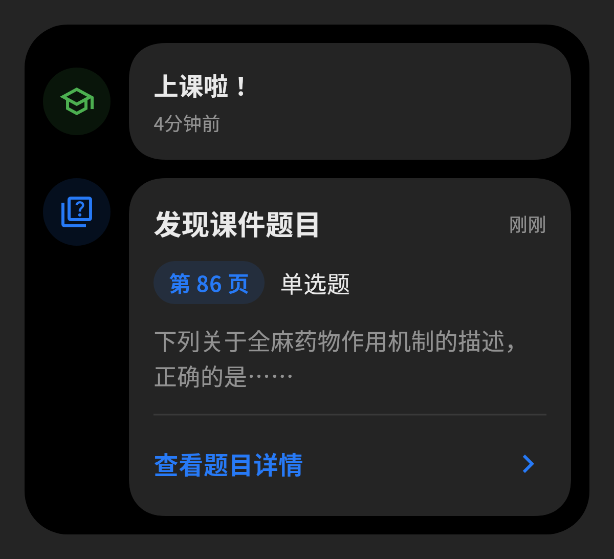

# PPT 题目发现卡片：参考图调整

基于导航转场分支 `codex/ios-style-navigation` 的 `4e7c340`，本次界面修改排在导航 PR #4 之后。

## 界面

- 时间线使用圆角浅灰容器；事件左侧为圆形图标，右侧为独立 Miuix 内容卡片。
- 发现提示显示“发现课件题目”、真实事件时间、蓝色页码标签、题型、两行题干摘要、分隔线及“查看题目详情”入口。
- 题干来自扫描快照的 `StandardizedQuestion.effectiveText`。摘要仅在显示时省略，详情保留完整内容。
- 无文字的图片题明确显示“图片内容尚未识别，请查看原页。”；卡片不额外请求题目图片，详情继续使用原有图片与原页预览。
- 超过 3 题保留默认折叠汇总；展开后逐题显示新版卡片。
- 历史卡片保留原课件标题；窄屏及大字号时标题/时间与页码/题型可换行。
- 颜色全部沿用 Miuix 主题，深色卡片没有写死白色背景。

实际 Flutter 渲染预览如下。图片中的第 86 页题干是用于视觉检查的测试示例，真实应用显示扫描到的内容；预览使用环境已有 CJK 字体，没有向应用增加字体依赖。

## 变更文件

| 文件 | 修改 |
| --- | --- |
| `lib/pages/widget/classroom_timeline_card.dart` | 共享圆形图标及 Miuix 内容卡片的纯视觉布局 |
| `lib/pages/widget/courseware_question_discovery_card.dart` | 新提示布局、真实摘要、时间、页码标签及详情入口；保留原详情/跳页回调及折叠状态 |
| `lib/pages/presentation.dart` | 传入现有时间格式化结果、时间线容器与事件视觉布局；保留正式历史题目的原 GestureDetector 点击路径 |
| `test/courseware_question_discovery_test.dart` | 更新新界面选择器并新增 7 项布局、摘要、历史、纯图片、窄屏及大字号测试 |
| `test/presentation_question_discovery_test.dart` | 点击新版入口；详情断言限定在详情弹窗内，保留原课堂状态、页码、竞态和请求断言 |
| `test/reverse_async_regression_test.dart` | 新布局增大留白后，先滚动到历史条目再点击，原历史加载和最新教师页断言不变 |
| `docs/screenshots/question-discovery-light.png` / `question-discovery-dark.png` | 实际组件渲染，供对照参考图 |

## 保留行为与反向审查

扫描器、模型、题目指纹、课时/课件隔离、重复消息去重、首次发现时间、异步代次保护、自动检索/答题、课堂控制、缓存和导出均使用原实现。发现提示仍是独立本地事件，点击仅查看详情；主动跳转仍保留教师所在页。

正式课堂历史题目与本地发现提示只共享视觉布局，不共用事件类型、解锁路径或点击处理。正式历史条目保留原 GestureDetector，包含图标在内的点击区域继续由原回调处理。

完整回归最初发现两项历史点击测试失败：新增留白使固定点击坐标位于 800×600 测试视口之外。已改为先滚动到历史条目，不删测试、不降低历史题目可打开或教师页保护的断言。单独 13 项历史/异步回归和最终完整测试均通过。

## 验证

- `dart format`：新增/修改的卡片、presentation 及识题测试通过；其他旧测试仅加入所需滚动操作，避免无关格式改动。
- `flutter analyze --no-pub`：无问题。
- 两个识题测试文件：**31 项通过**。
- `flutter test --no-pub test/reverse_async_regression_test.dart --reporter expanded`：**13 项通过**。
- `flutter test --no-pub --reporter expanded`：**490 项通过，7 项既有跳过**。
- 浅色和深色实际渲染图已查看；320 像素窄屏、1.2/2.0 倍字号及多题展开无溢出。
- `git diff --check`：通过。

此改动尚未合并主线，也尚未重新发布安装包；已有 test92 对应导航版本，不包含这次界面调整。没有新增 OCR，也没有 Android/iOS 真机上的新布局验收。
